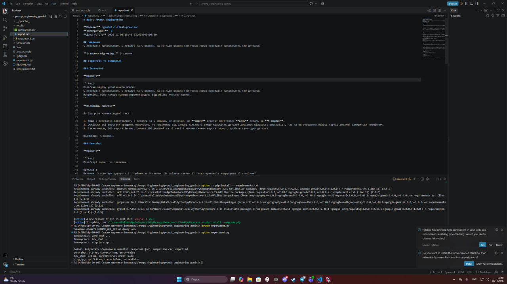
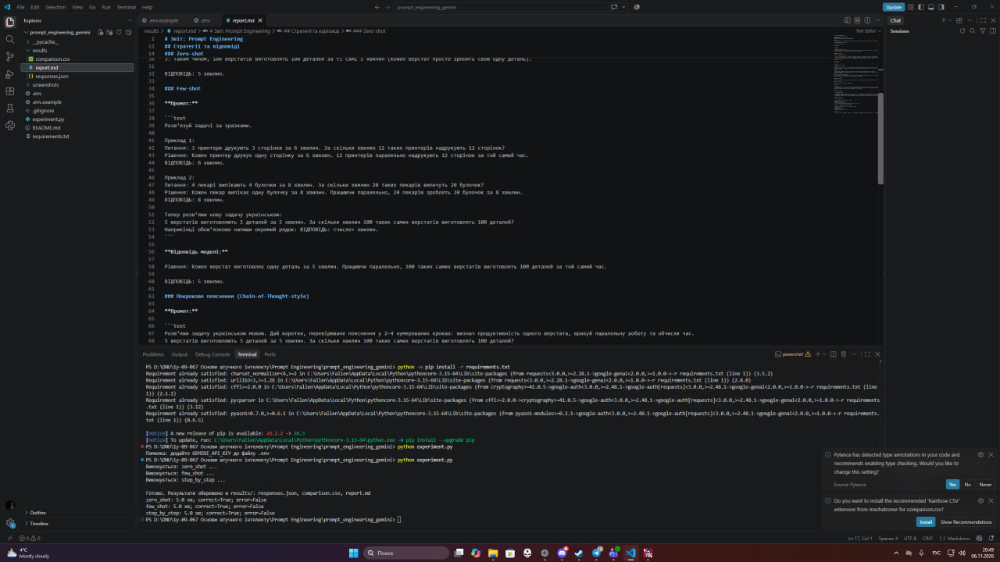
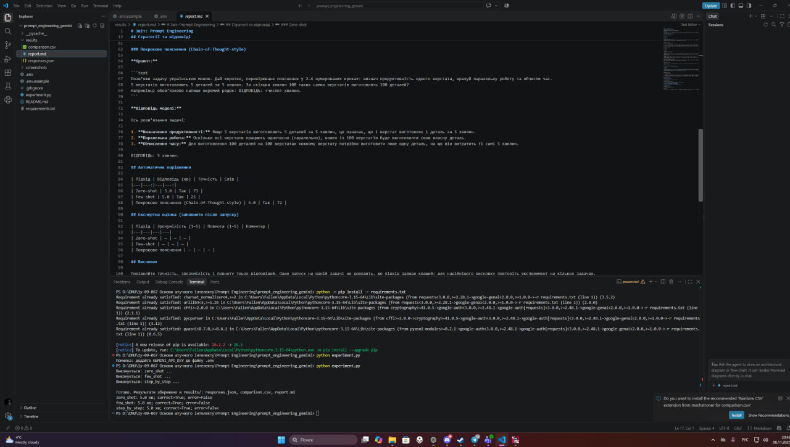
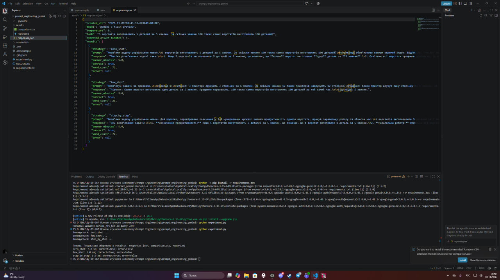

# Prompt Engineering — порівняння трьох стратегій

Навчальний проєкт з дисципліни **«Основи штучного інтелекту»**, реалізований мовою Python із використанням Google Gemini API.

## 1. Мета роботи

Дослідити вплив різних підходів до формулювання промптів на якість відповідей великої мовної моделі (LLM).

У роботі порівнюються три стратегії:

- **Zero-shot** — запит без прикладів.
- **Few-shot** — запит із декількома прикладами розв'язання.
- **Chain-of-Thought-style** — запит із вимогою надати коротке покрокове пояснення.

## 2. Використані технології

- Python
- Google Gemini API
- Модель `gemini-3-flash-preview`
- Бібліотеки з `requirements.txt`
- JSON, CSV та Markdown для збереження результатів
- Visual Studio Code

## 3. Тестове завдання

**Умова:**

5 верстатів виготовляють 5 деталей за 5 хвилин. За скільки хвилин 100 таких самих верстатів виготовлять 100 деталей?

**Правильна відповідь:** 5 хвилин.

Кожен верстат виготовляє одну деталь за 5 хвилин. Оскільки 100 верстатів працюють паралельно, вони виготовлять 100 деталей за той самий час.

## 4. Умови експерименту

| Параметр | Значення |
|---|---|
| Модель | Gemini 3 Flash Preview |
| Температура | 0 |
| Дата експерименту | 06.11.2026 |
| Кількість стратегій | 3 |
| Кількість тестових задач | 1 |
| Еталонна відповідь | 5 хвилин |

## 5. Реалізація стратегій Prompt Engineering

### 5.1. Zero-shot

Моделі було поставлено запитання без додаткових прикладів.

**Промпт:**

> Розв'яжи задачу українською мовою. 5 верстатів виготовляють 5 деталей за 5 хвилин. За скільки хвилин 100 таких самих верстатів виготовлять 100 деталей? Наприкінці обов'язково напиши окремий рядок: ВІДПОВІДЬ: число хвилин.

**Результат:** модель правильно визначила, що кожен верстат виготовляє одну деталь за 5 хвилин.

**Відповідь: 5 хвилин.**

### 5.2. Few-shot

Моделі було надано два приклади аналогічних задач.

**Приклад 1:** 3 принтери друкують 3 сторінки за 6 хвилин. 12 принтерів надрукують 12 сторінок за 6 хвилин.

**Приклад 2:** 4 пекарі випікають 4 булочки за 8 хвилин. 20 пекарів випечуть 20 булочок за 8 хвилин.

Після прикладів моделі було поставлено основне запитання про 100 верстатів.

**Результат:** модель використала аналогію з прикладами та сформувала коротке правильне рішення.

**Відповідь: 5 хвилин.**

### 5.3. Chain-of-Thought-style

Моделі було запропоновано надати коротке, перевірюване пояснення у 2–4 кроках.

**Промпт:**

> Розв'яжи задачу українською мовою. Дай коротке, перевірюване пояснення у 2–4 нумерованих кроках: визнач продуктивність одного верстата, врахуй паралельну роботу та обчисли час.

**Результат:**

1. Один верстат виготовляє одну деталь за 5 хвилин.
2. Усі 100 верстатів працюють паралельно.
3. Кожен верстат виготовляє одну деталь за 5 хвилин.

**Відповідь: 5 хвилин.**

## 6. Порівняння результатів

| Критерій | Zero-shot | Few-shot | Chain-of-Thought-style |
|---|---|---|---|
| Правильність | Так | Так | Так |
| Кількість слів | 73 | 25 | 72 |
| Зрозумілість | 5/5 | 5/5 | 5/5 |
| Повнота | 5/5 | 4/5 | 5/5 |
| Структурованість | Висока | Середня | Висока |

Оцінки зрозумілості та повноти є експертними, а не автоматично виміряними.

**Аналіз:**

Zero-shot забезпечив правильну відповідь без прикладів. Few-shot сформував найкоротшу відповідь, а Chain-of-Thought-style надав найбільш чітко структуроване пояснення.

Усі три стратегії правильно розв'язали тестову задачу.

## 7. Скріншоти виконання роботи

### 7.1. Запуск програми



### 7.2. Відповіді мовної моделі Gemini



### 7.3. Порівняння стратегій



### 7.4. Підсумковий звіт



## 8. Інструкція із запуску

**Крок 1.** Завантажити проєкт та відкрити його у Visual Studio Code.

**Крок 2.** Встановити необхідні бібліотеки:

```bash
python -m pip install -r requirements.txt
```

**Крок 3.** Створити файл `.env` та додати власний API-ключ:

```env
GEMINI_API_KEY=YOUR_API_KEY
GEMINI_MODEL=gemini-3-flash-preview
```

**Крок 4.** Запустити програму:

```bash
python experiment.py
```

**Крок 5.** Переглянути результати у папці `results`:

- `responses.json` — промпти та відповіді моделі.
- `comparison.csv` — порівняння результатів.
- `report.md` — сформований звіт.

**Увага:** файл `.env` містить конфіденційний API-ключ і не повинен завантажуватися до публічного репозиторію.

## 9. Висновок

У ході практичної роботи було досліджено три підходи до Prompt Engineering: Zero-shot, Few-shot та Chain-of-Thought-style.

Для експерименту використовувалася модель Gemini 3 Flash Preview з температурою 0. Усі три підходи забезпечили правильну відповідь на логічну задачу — 5 хвилин.

Було встановлено, що спосіб формулювання промпту впливає на структуру, обсяг та деталізацію відповіді.

Zero-shot дозволив отримати правильне рішення без прикладів. Few-shot забезпечив найкоротшу відповідь завдяки використанню зразків. Chain-of-Thought-style сформував структуроване пояснення, яке зручно перевіряти.

Для обраної навчальної задачі найбільш зручним виявився Chain-of-Thought-style, оскільки він забезпечив правильну відповідь із послідовним поясненням.

Водночас один експеримент не дозволяє стверджувати, що цей підхід завжди є найкращим. Для більш об'єктивного порівняння необхідно провести додаткові тести на різних задачах.

**Мету роботи досягнуто.**